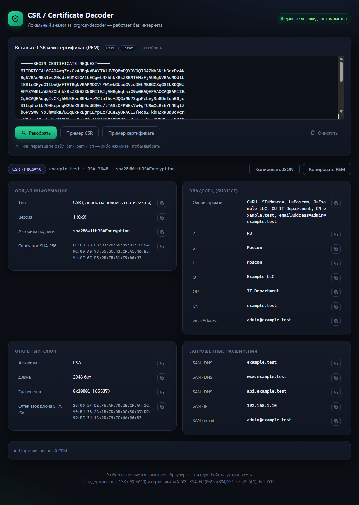

# CSR / Certificate Decoder

**Демо:** [darktech.ru/tools/csr-decoder](https://darktech.ru/tools/csr-decoder/)

Локальный декодер CSR (PKCS#10) и SSL-сертификатов (X.509) — аналог онлайн-инструментов вроде ssl.org/csr-decoder, работающий **полностью офлайн**. Один самодостаточный HTML-файл без зависимостей, фреймворков и внешних запросов: все данные разбираются в вашем браузере и никуда не отправляются.



## Возможности

- **Разбор CSR (PKCS#10)** и **сертификатов X.509** в PEM-формате, включая заголовок `NEW CERTIFICATE REQUEST`
- Понятные карточки по разделам:
  - Subject / Issuer (CN, O, OU, C, ST, L, emailAddress и другие)
  - Срок действия с цветным статусом («действует / истекает / истёк»)
  - Серийный номер, версия, алгоритм подписи
  - SAN: DNS, IP, email, URI
  - Расширения: keyUsage, extendedKeyUsage, basicConstraints, SKI/AKI, CRL Distribution Points, Authority Information Access — с пометкой `critical`
  - Отпечатки SHA-256 / SHA-1 сертификата и открытого ключа
- **Кнопка копирования у каждого значения** (с индикацией), экспорт всего результата в JSON, копирование нормализованного PEM
- Drag & drop файла `.csr` / `.pem` / `.crt`, выбор файла по клику, вставка текста
- Встроенные примеры: «Пример CSR» и «Пример сертификата» — можно посмотреть работу без своих данных
- Горячая клавиша `Ctrl+Enter` — разобрать

## Поддерживаемые алгоритмы

| Тип | Что показывается |
|---|---|
| RSA | размер ключа, экспонента |
| EC | кривая: P-224/256/384/521, secp256k1, brainpool |
| Ed25519 / Ed448 | размер ключа |
| Подписи | RSA (SHA-1/256/384/512, PSS), ECDSA, Ed25519 |

## Использование

Скачайте `index.html` и откройте двойным кликом в любом современном браузере — этого достаточно.

Либо склонируйте репозиторий:

```bash
git clone <url>
```

и откройте `index.html`. Сервер не требуется; при желании можно раздать через любой статический сервер (`python -m http.server`).

**Требования:** любой современный браузер (Chrome/Edge 87+, Firefox 105+, Safari 14+) на любой ОС. Интернет не нужен.

## Как это работает

PEM-текст → Base64-декодирование → бинарная структура DER (ASN.1) → разбор собственным парсером на чистом JavaScript:

- все поля (Subject, SAN, ключ, расширения, даты) читаются напрямую из ASN.1-структуры — без внешних словарей и сетевых запросов;
- отпечатки вычисляются через Web Crypto API (`crypto.subtle`);
- копирование — через Async Clipboard API с fallback на `execCommand`.

Никакие библиотеки не подключаются: страница работает на компьютере без доступа в сеть.

## Структура проекта

```
index.html     — всё приложение (HTML + CSS + JS в одном файле)
screenshot.png — скриншот
README.md
```

## Ограничения

- Декодируется первый PEM-блок во вводе (при вставке цепочки покажет подсказку).
- Страница показывает, что записано в сертификате, но **не проверяет подлинность подписи** и статус отзыва — это задача валидации, а не декодирования.
- В небезопасном контексте (обычный `http://` не с localhost) строки с отпечатками могут не отображаться — ограничение Web Crypto API в браузерах.

---

Разработано [DarkTech](https://darktech.ru)
